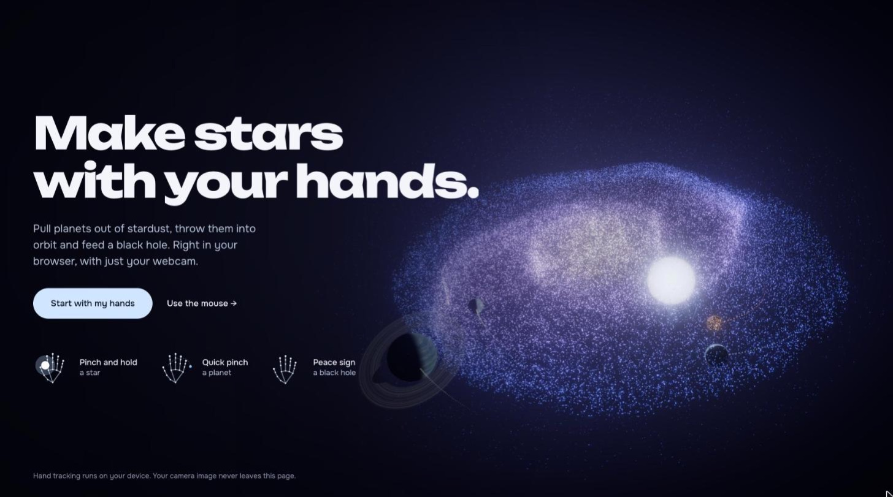
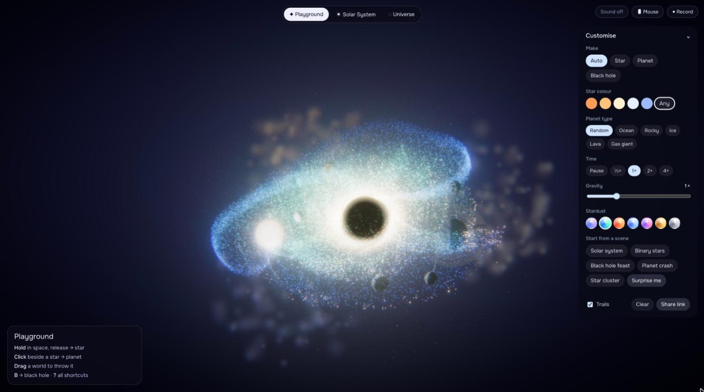
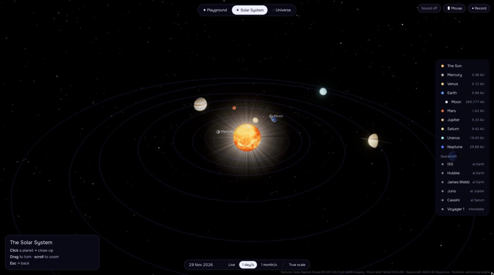
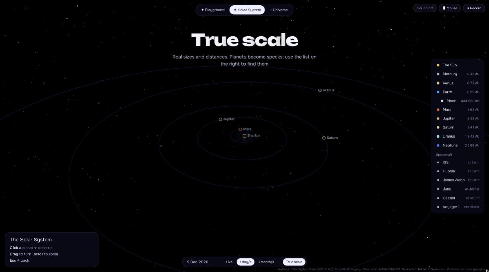
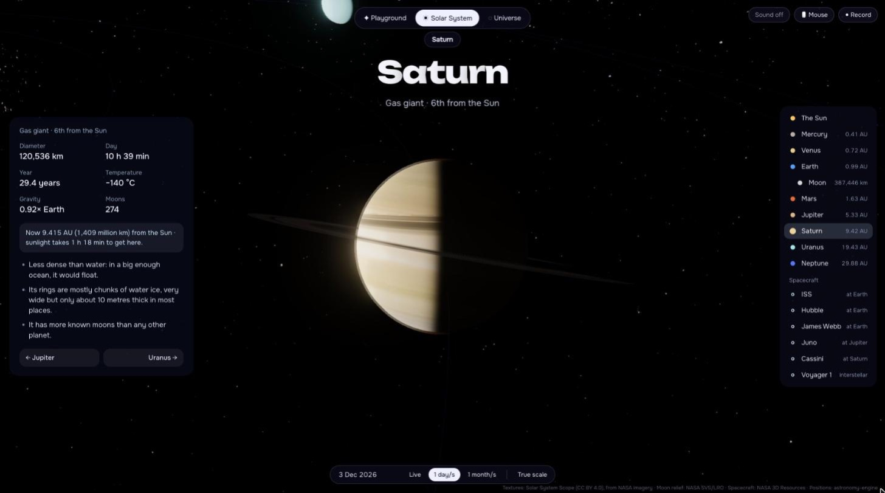
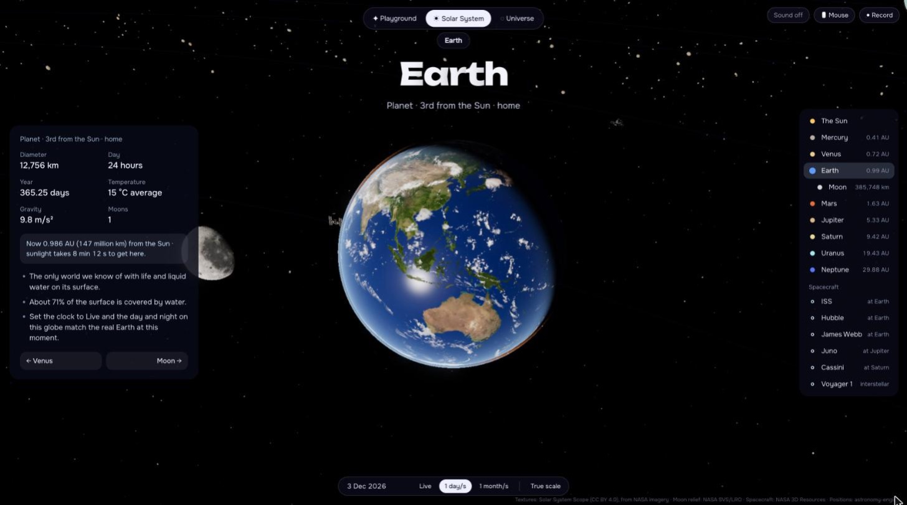

<div align="center">

# ✦ Aether

### Make stars, planets and black holes with your bare hands.

Pinch stardust into a star, throw a planet into orbit, hold up a peace sign and watch a black hole swallow it all.<br>
Then visit our real Solar System, with every planet where it is today. All in your browser, with just a webcam.

**[▶ Try it live](https://aether-hands.vercel.app)** · runs in Chrome, Edge or Safari 26+ (WebGPU)



</div>

---

## Three places to explore

| | |
|---|---|
|  | **✦ Playground**<br>Empty space full of stardust. Make anything; nothing can go wrong. Open **Customise** to choose what you make, bend time and gravity, recolour the stardust, start from a scene, and share a link to what you made. |
|  | **☀ The Solar System**<br>Our real Solar System, explore-only. Every planet and the Moon is where it really is today, on its true axis and orbit. Earth shows the real time of day. NASA spacecraft fly alongside. |
|  | **◌ The Universe**<br>110 galaxies to fly into, each with star systems to visit and create in. Our own, the Milky Way, is marked *you are here*. Switch the Solar System to **true scale** to feel how empty space really is. |

## Gestures

Hand tracking runs entirely on your device. Your camera image never leaves the page.

| With your hands | | With a mouse |
|---|---|---|
| 🤏 **Pinch and hold**, let go | a **star**; hold longer for a bigger, bluer star | hold in space, release |
| 🤏 **Quick pinch** beside a star | a **planet**; move as you let go to throw it (a line previews its orbit) | click beside a star |
| 🤏 **Pinch a world** | grab it, move it, throw it | drag it |
| 🤏🤏 **Both hands on one star**, pull apart | it swells, then goes **supernova** | |
| ✌️ **Hold a peace sign** (½ s) | a **black hole** where your hand is | **B** |
| 👉 **Point and hold** | go closer (galaxy → star system → close-up); on a button, presses it | click |
| ✋ **Sweep an open hand** | blow the stardust like wind; turn the view | drag |
| ✋✋ **Both palms up**, still | go back one level | **Esc** |

Every control, including the Customise panel, the legend and the clock, can be pressed by pointing at it and holding, so Aether works with hands alone.

## The Playground studio

- **Make:** Auto (the gesture decides), Star, Planet or Black hole
- **Star colour:** red dwarf, orange, Sun-like, white or blue giant. **Planet type:** ocean, rocky, ice, lava, gas giant
- **Time:** pause, ½×, 1×, 2×, 4×. **Gravity:** from a quarter to triple strength. Trails on or off
- **Stardust themes:** Nebula, Aurora, Ember, Glacier, Rose, Gold, Mono
- **Scenes:** solar system, binary stars, black hole feast, planet crash, star cluster, *surprise me*
- **Share link:** your whole creation is encoded in the URL. Anyone who opens it sees exactly what you made
- **Record:** a vertical 1080×1920 clip, ready to post

## A Solar System that's actually real



- **Where things are today:** planet and Moon positions from [astronomy-engine](https://github.com/cosinekitty/astronomy), with real orbit shapes and inclinations, real spin axes (IAU poles) and Earth turned to the true time of day. A clock runs live, 1 day/s or 1 month/s.
- **Click anything to learn about it:** numbers from NASA's planetary fact sheet, three facts, and a live line showing the real distance right now and how long light takes to get there. ← → step through every body.
- **Looks:**
  - 8K/4K NASA-based textures;
  - Earth with city lights at night, ocean glint, and clouds that cast shadows;
  - crater relief on the Moon from NASA LRO elevation data;
  - Saturn's ring shadow on the planet and its own shadow on the rings;
  - a granulated Sun with darker edges.
- **Spacecraft:** NASA models of the ISS, Hubble, James Webb (at L2), Juno, Cassini and Voyager 1, enlarged so you can see them.
- **True scale (T):** real sizes and distances, blended smoothly. A legend finds everything too small to see.



## Sound

Every planet gets its own note on a pentatonic scale (gas giants low, ice worlds high) and rings softly each time it completes an orbit. A solar system becomes a little melody. Stars bloom as warm chords, black holes fall away in a deep tone, supernovae end in a shimmer. **M** toggles sound.

## How it works

- **Rendering:** three.js r187 `WebGPURenderer` with TSL node materials. The stardust is 240,000 particles simulated in a GPU compute shader: hand wind and vortices, every finger joint as a collider, star gravity, black-hole capture. Post-processing adds bloom and lensing.
- **Hand tracking:** MediaPipe's Gesture Recognizer runs in a module Web Worker on the GPU delegate, giving 21 landmarks per hand plus built-in gestures. Gesture reading is Aether's own:
  - a pinch needs touching fingertips and a short hold;
  - a fist needs the index folded back;
  - pointing is suppressed during ✌️;
  - every gesture is smoothed with a One Euro filter, hysteresis latches and velocity prediction.

  Pinches hit-test at the real fingertip midpoint, so grabbing lands where you pinch.
- **Physics:** a CPU N-body simulation with merges, orbit assistance and trails. Real planets follow the ephemeris, not physics.
- **Verified on real data:** gesture reading was tested against real hand photos and videos through the real model, not just simulated input.
- **Built to stay smooth:**
  - loops run only over bodies and hands that exist;
  - objects too small to see aren't drawn;
  - dead particles cost nothing;
  - places are cleaned up when you leave;
  - a safety switch drops to lighter graphics if frames stay slow.

## Run it locally

```bash
git clone https://github.com/hardikverma22/aether-universe.git
cd aether-universe
npm install
npm run dev
```

Open http://localhost:5195 in a WebGPU browser. On battery, Chrome's Energy Saver caps pages at 30 fps; plug in for 60.

**Developer flags** (add to the URL):

| Flag | Does |
|---|---|
| `?debug` | frame time, render fps, hand-tracking rate |
| `?lite` | lighter graphics |
| `?handsim` | simulated hands for testing without a camera: `window.__startHandSim()`, then `__sim.set(hand, 'pinch' \| 'point' \| 'fist' \| 'victory' \| 'open', x, y)` or `await __sim.aim(hand, pose, px, py)` |

## Project layout

```
src/
  main.js        places, camera rig, HUD, input routing, overlay, render loop
  hands.js       hand pipeline: smoothing, gesture reading, prediction
  handWorker.js  MediaPipe Gesture Recognizer in a Web Worker
  create.js      creation: gather, star, planet, black hole, grab and throw, supernova
  sim.js         240k-particle stardust (GPU compute)
  bodies.js      N-body physics, merges, trails
  system.js      star systems and our real Solar System
  ephem.js       real positions, axes and Earth's rotation (astronomy-engine)
  craft.js       NASA spacecraft and the asteroid belt
  facts.js       info panels (NASA fact sheet data)
  studio.js      Playground Customise panel, scenes, share links
  audio.js       synthesised sound and the music of the spheres
  universe.js    the 110-galaxy universe
```

## Credits

- **Textures:** [Solar System Scope](https://www.solarsystemscope.com/textures/), based on NASA imagery, CC BY 4.0
- **Moon relief:** NASA Scientific Visualization Studio, [CGI Moon Kit](https://svs.gsfc.nasa.gov/4720) (LRO)
- **Spacecraft models:** [NASA 3D Resources](https://github.com/nasa/NASA-3D-Resources)
- **Planet data:** NASA NSSDC [Planetary Fact Sheet](https://nssdc.gsfc.nasa.gov/planetary/factsheet/)
- **Positions:** [astronomy-engine](https://github.com/cosinekitty/astronomy) by Don Cross (MIT)
- **Hand tracking:** [MediaPipe](https://developers.google.com/mediapipe) Gesture Recognizer (Apache 2.0)
- **Rendering:** [three.js](https://threejs.org) (MIT); animation by [GSAP](https://gsap.com)

Full asset credits: [`public/textures/CREDITS.md`](public/textures/CREDITS.md).
